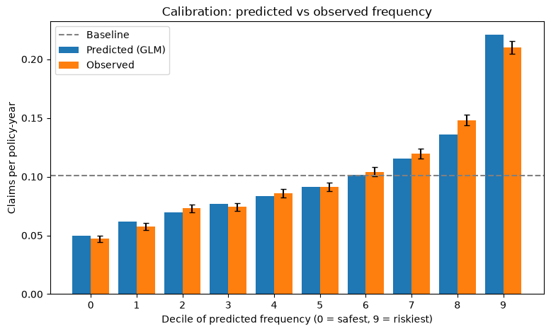

# AutoRisk — Claim Frequency Modelling for Motor Insurance

Predicting how often a motor-insurance policyholder files a claim, using the French MTPL dataset (`freMTPL2freq`, 678,013 policies).
The project starts from a classical actuarial **Poisson GLM**, evaluates it against a baseline and a simulated **noise floor**, and checks **calibration** across risk deciles. Gradient boosting and Bayesian hierarchical models are planned next (see [Next steps](#next-steps)).

---

## 1. Problem

An insurer has to charge each customer a premium that matches their expected loss. The expected loss splits into

$$
\text{pure premium} = \underbrace{\text{claim frequency}}_{\text{this project}} \times \text{claim severity}
$$

This repository models the **frequency** part: the expected number of claims per policy-year, given driver, vehicle and region characteristics.

Charging everyone the same average premium is costly in both directions: low-risk customers are overcharged and leave, high-risk customers are undercharged and stay (adverse selection). A good frequency model must therefore **rank** risks correctly and **predict their level** accurately.

## 2. Data

`freMTPL2freq` (available on OpenML, `data_id=41214`): one row per policy.

| Column | Meaning |
|---|---|
| `ClaimNb` | Number of claims in the observation period (target) |
| `Exposure` | Length of the observation period in years (≤ 1) |
| `DrivAge` | Age of the policyholder |
| `BonusMalus` | Bonus-malus level: 50 = best, 100 = starting level, > 100 = after claims |
| `VehPower`, `VehAge`, `VehBrand`, `VehGas` | Vehicle characteristics |
| `Density` | Population density where the driver lives |
| `Region`, `Area` | Geographic region / area category |

- Overall observed frequency: **≈ 0.10 claims per policy-year**
- The vast majority of policies have zero claims.
- Train / test split: 80 / 20 with a fixed seed (542,410 / 135,603 policies). All models are compared on the same test set.

## 3. Method

### 3.1 Poisson GLM with exposure offset

Claim counts are modelled as Poisson with a log link:

$$
\log \mathbb{E}[\text{ClaimNb}_i] = \log(\text{Exposure}_i) + \beta_0 + \sum_j \beta_j x_{ij}
$$

The term $\log(\text{Exposure}_i)$ is an **offset** (coefficient fixed to 1). It ensures that a policy observed for 3 months is expected to have a quarter of the claims of an identical policy observed for a year, so the coefficients describe the **risk per year** rather than the length of the contract.

Because of the log link, $\exp(\beta_j)$ is a **multiplicative relativity**. The fitted model can therefore be read directly as a rating table (e.g. "× 3.9 for BonusMalus = 100").

Implementation: `statsmodels` (`sm.GLM`, `family=Poisson()`, `offset=np.log(Exposure)`).

### 3.2 Features

All features enter the GLM as categorical dummies (reference level = first category):

| Feature | Binning |
|---|---|
| `DrivAge` | 18–25, 26–35, 36–45, 46–55, 56–65, 66+ |
| `BonusMalus` | 50, 51–90, 91–99, **100**, 101+ (chosen manually from the observed-frequency plot) |
| `VehPower`, `VehAge`, `log(Density)` | quantile bins |
| `VehGas`, `VehBrand`, `Region` | original categories |
| `Area` | **dropped** (redundant with `Density`, see 4.3) |

### 3.3 Evaluation

- **Mean Poisson deviance** on the test set (lower is better).
- **Baseline**: every policy gets the overall train frequency.
- **Noise floor**: the deviance a model would still have if its predictions were exactly the true rates (see 4.5).
- **Calibration by decile**: test policies sorted by predicted frequency and split into 10 groups of equal exposure; predicted vs. observed frequency per group.

## 4. Results and findings

### 4.1 Model performance

| Model | Mean Poisson deviance (test) |
|---|---|
| Baseline (constant frequency) | 0.3314 |
| **Poisson GLM** | **0.3209** |
| Noise floor (simulated, if GLM were the true model) | 0.2834 ± 0.0024 |

In absolute terms the GLM improves on the baseline by only ~3 %. However, most of the deviance cannot be removed by any model (see 4.5). Of the **reducible** gap between baseline and noise floor (0.048), the GLM closes about **22 %**.

### 4.2 BonusMalus is the dominant risk factor

| BonusMalus | Relativity vs. 50 |
|---|---|
| 50 | 1.00 |
| 51–90 | 1.67 |
| 91–99 | 2.48 |
| 100 | 3.85 |
| 101+ | 5.31 |

The effect is monotone. Splitting off **BonusMalus = 100** (mostly new policyholders) was important: with only two bins (≤ 100 / > 100), experienced drivers at level 50 and new drivers at level 100 were mixed together.

### 4.3 Confounding: young drivers vs. new drivers

Driver-age coefficients (vs. 18–25), same age bins, with two different BonusMalus binnings:

| Age | BonusMalus in 2 bins | BonusMalus in 5 bins (100 separated) |
|---|---|---|
| 26–35 | −0.51 | −0.30 |
| 36–45 | −0.48 | −0.03 |
| 46–55 | −0.39 | +0.15 |
| 56–65 | −0.54 | +0.02 |
| 66+ | −0.47 | +0.12 |

With coarse BonusMalus bins the model attributed the high risk of **new drivers** to **young age**, because most new drivers are young. Once BonusMalus = 100 is its own category, most of the apparent age effect disappears:

> A large part of the "young driver" risk is explained by short driving history (BonusMalus = 100), not by age itself.

A residual age effect remains (18–25 still ≈ 1.35× riskier than 26–35). The positive coefficient for 46–55 is plausibly due to **young secondary drivers** (e.g. children) using a parent's car: `DrivAge` is the age of the policyholder, not necessarily of the person driving. This cannot be verified with the available data.

### 4.4 Other effects

- **Vehicle age**: new cars (0–2 years) have the highest frequency; cars older than 12 years ≈ 0.55×.
- **Density vs. Area**: both describe urban vs. rural. With both in the model, the Density coefficients were weak (top bin: 0.11, s.e. 0.063, p = 0.08). After dropping `Area`, the same coefficient became 0.22 (s.e. 0.022, p < 0.001), while the training deviance changed by only ~10 for 5 fewer parameters → classic **multicollinearity**; `Area` was removed.
- **Vehicle brand**: most brands are indistinguishable from the reference; **B12** stands out consistently (≈ 1.22×).
- **Overdispersion**: Pearson χ² / d.f. ≈ 2.6, i.e. the data are more dispersed than a Poisson model assumes. Standard errors and p-values above are therefore optimistic (see Next steps).

### 4.5 How much error is unavoidable? (noise floor)

Even a perfect model cannot predict *whether* an individual with a true rate of 0.07 claims/year will have an accident this year, just as knowing a light source's intensity does not let you predict individual photon counts (shot noise).

To quantify this, claim counts were simulated 100 times as $y^{\text{sim}} \sim \text{Poisson}(\hat\mu_{\text{GLM}})$ on the test set, and the deviance of the GLM's own predictions against these simulated outcomes was computed.

| | Mean Poisson deviance |
|---|---|
| Simulated (model assumed true) | 0.2834 ± 0.0024 |
| Actual test set | 0.3209 |

- About **88 %** of the GLM's test deviance is irreducible Poisson noise.
- The remaining gap is **highly significant** (z ≈ 15.6). Part of it is structure the GLM misses (e.g. interactions), part is unobserved heterogeneity between drivers (overdispersion), which no model built on these features can remove.

*Caveat: the floor is estimated under the assumption that the GLM's predictions are the true rates, so it is an approximation.*

### 4.6 Calibration by risk decile



| Decile | Predicted freq. | Observed freq. |
|---|---|---|
| 0 (safest) | 0.050 | 0.047 |
| 5 | 0.091 | 0.091 |
| 8 | 0.136 | 0.148 |
| 9 (riskiest) | 0.221 | 0.210 |

- Observed frequency rises almost monotonically across deciles: the **riskiest 10 % have 4.5× the claim frequency of the safest 10 %**.
- In 8 of 10 deciles the prediction lies within ~1.5 standard errors of the observed value. Total predicted claims on the test set are within 0.5 % of the observed total.
- About **60 %** of policies have a predicted risk below the portfolio average, so a flat premium would overcharge the majority of customers.
- Slight **over-prediction in the top decile** (and under-prediction in decile 8): multiplicative effects can stack up too strongly for policies combining several risk factors. This is a candidate for improvement with tree-based models.

Although the deviance improvement over the baseline looks small, the model separates risks by a factor of 4–5, which is what matters for pricing.

## 5. Pitfalls encountered (and fixed)

- **`pd.qcut(..., duplicates="drop")` on heavily tied variables**: `BonusMalus` has large point masses at 50 and 100. Quantile edges collapsed and were silently dropped, producing very unequal bins. Fixed by manual bins with `pd.cut`.
- **Copy-paste binning bug**: three supposedly different features were all binned from the same column, giving three identical sets of dummies (identical coefficients and standard errors, slow IRLS convergence). Detected from the summary table and fixed.
- **Offset at prediction time**: `results.predict(X_new)` silently assumes `offset = 0` (i.e. 1 year of exposure) unless the offset is passed explicitly. Sanity check used: for a Poisson GLM with intercept, the sum of fitted values equals the sum of observed claims on the training set.
- **Comparing deviances**: deviance is a *sum* over rows, so models must be compared on the same data, or via the *mean* deviance.

## 6. Project structure

```
AutoRisk/
├── src/mip/
│   ├── config.py                    # paths, seed, test size
│   ├── load_data.py                 # download freMTPL2 from OpenML into data/
│   ├── DataUnderstand/
│   │   └── group_analysis.py        # binning helpers, exploratory plots
│   ├── models/
│   │   ├── baseline.py              # constant-frequency baseline
│   │   └── poissonGLM.py            # GLM fit, prediction, noise floor
│   └── evaluations/
│       └── calibration_plot.py      # calibration by risk decile
├── notebooks/
│   └── explore_data.ipynb           # reproduces the tables in this README
├── figures/
└── README.md
```

### Setup and run

Requires [uv](https://docs.astral.sh/uv/). `data/`, `saved_models/` and `saved_mu/` are not tracked in git; the commands below recreate them.

```bash
uv sync                                                # create .venv and install the mip package
uv run python src/mip/load_data.py                     # download the data into data/
uv run python src/mip/models/poissonGLM.py             # fit the GLM (or load it if saved), write test predictions
uv run python src/mip/evaluations/calibration_plot.py  # figures/poissonGLM/calibration.png
```

## 7. Next steps

- [ ] **Lorenz curve and Gini coefficient** to quantify risk ranking.
- [ ] **Gradient boosting** (LightGBM, Poisson objective, exposure as `init_score`) evaluated with the same metrics; check whether it improves the top deciles and how much of the reducible gap it closes.
- [ ] **Overdispersion**: quasi-Poisson standard errors (`scale="X2"`) and/or a Negative Binomial model.
- [ ] **Bayesian hierarchical model** (PyMC) with partial pooling over `Region`, compared with no pooling, and related to Bühlmann credibility theory.
- [ ] **Severity model** (Gamma GLM on `freMTPL2sev`) and pure premium = frequency × severity.
- [ ] **Fairness note**: since 2012 (EU Test-Achats ruling), gender may not be used as a rating factor in the EU. The dataset contains no gender variable, but proxy effects of other variables could be examined.

---

## Kurzfassung (Deutsch)

Modellierung der **Schadenhäufigkeit** in der Kfz-Haftpflicht auf dem französischen Datensatz freMTPL2 (678.013 Verträge) mit einem **Poisson-GLM** inklusive Exposure-Offset.

- Der **Bonus-Malus-Grad** ist der stärkste Risikofaktor (bis zu 5,3-fache Häufigkeit gegenüber Grad 50).
- Ein großer Teil des scheinbaren Risikos junger Fahrer wird durch eine **kurze Schadenhistorie** (Bonus-Malus = 100, überwiegend Neukunden) erklärt (**Confounding**).
- Eine **Simulation des Poisson-Rauschens** zeigt, dass rund 88 % der Test-Devianz nicht reduzierbar ist; vom reduzierbaren Anteil schließt das GLM etwa 22 %.
- Das Modell ist über alle Risikodezile gut **kalibriert**; die riskantesten 10 % haben eine 4,5-fach höhere Schadenhäufigkeit als die sichersten 10 %.

Nächste Schritte: Gradient Boosting, Gini-Koeffizient, Overdispersion, Bayes'sches hierarchisches Modell (Bezug zur Credibility-Theorie) und Schadenhöhenmodell.